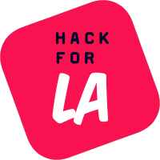

<a name="readme-top"></a>

<div align="center">
  

  <h1>Tables — Volunteer Onboarding & Offboarding Automation</h1>

  <p>
    The production automation system that keeps Hack for LA running
  </p>


</div>

---

## What is Tables?

Hack for LA runs on volunteers — over **200 active contributors** across **30+ open source civic tech projects**. Every one of them needs access to the right tools, teams, and resources before they can contribute. When they leave, that access needs to be cleanly revoked.

All automation created by the Tables team reduces the administrative burden on several volunteer roles:  Executive Director, Onboarding Leads, Community of Practice Leads, Product/Project Managers.

**Tables is the system that makes that happen automatically.**

When A volunteer submits a form, it is processed by Tables automations. Reduced manual steps, accurate permissions, minimized or controlled security gaps. All actions are logged and traceable.

Tables currently serves as Hack for LA's **operational continuity layer** — the production system managing human capital automation while two longer-running infrastructure projects ([VRMS](https://github.com/hackforla/VRMS) and [PeopleDepot](https://github.com/hackforla/peopledepot)) continue development.

---

## Impact

- **2000+ volunteers** onboarded and managed across the org
- **30+ active projects** with automated access provisioning
- **5 integrated platforms** managed from a single workflow
- **Zero infrastructure cost** — fully serverless on Google's free tier
- **Full audit trail** on every automation run, success or failure
- Serves as the **reference implementation** for permission logic and data schema that VRMS and PeopleDepot will inherit

---

## Technology Stack

<div align="center">

[![Google Apps Script][gas-shield]][gas-url]
[![Google Sheets][sheets-shield]][sheets-url]
[![GitHub Actions][github-actions-shield]][github-actions-url]
[![JavaScript][js-shield]][js-url]
[![Clasp][clasp-shield]][clasp-url]
[![Docker][docker-shield]][docker-url]

</div>

| Layer | Technology |
|---|---|
| Runtime | Google Apps Script (serverless) |
| Database | Google Sheets |
| Frontend Input | Google Forms |
| Deployment | Clasp + GitHub Actions CI/CD |
| API Integrations | GitHub, Google Drive, 1Password, Zoom, Slack |
| Containerization | Docker (1Password CLI API service) |

### Why This Stack?

Tables runs entirely within the Google ecosystem at zero cost, which a deliberate architectural decision that keeps the system sustainable for a volunteer organization.

Building these reliable, maintainable services with cost constraints increases the need for creativity and engineering discipline.  

---

## Project Context: Where Tables Fits

```
┌──────────────────────────────────────────────────────┐
│               Hack for LA Ecosystem                  │
│                                                      │
│  VRMS          ← volunteer-facing platform (in dev)  │
│  PeopleDepot   ← central data store / API (in dev)   │
│                                                      │
│  Tables        ← production automation TODAY         │
│  (this repo)     bridging the gap while they build   │
└──────────────────────────────────────────────────────┘
```

VRMS has been in development since 2019. PeopleDepot since 2021. In that time, Hack for LA has continuously onboarded thousands of volunteers. When those systems reach production, Tables' permission model, data schema, and automation logic will directly inform their architecture.

---

## What You'll Work On

Tables is in active development. Current work spans automation logic, infrastructure, and engineering process. This project provides hands-on experience making technical decisions on a live production system.

**Active**
- **General onboarding automation** — the monthly org-wide pipeline that processes every new HFLA volunteer, verifies attendance, and provisions access across the platform stack. Highest-traffic automation in the system
- **1Password CLI API** —  an internal REST API wrapping the 1Password CLI, used by the onboarding and offboarding pipelines for vault and team management.
- **CI/CD pipeline redesign** — building a proper staging → production promotion workflow with automated gates and environment isolation
- **Test infrastructure design** —  defining the unit vs. integration test boundary for Apps Script constraints and wiring tests into the PR workflow
- **Developer workflow standardization** — defining the contribution workflow for a rotating volunteer team: pre-push hooks, branch conventions, review standards, and the tooling that makes it safe for new engineers to ship without breaking production
- **Schema and data integrity hardening** — redesigning how the system interfaces with its data layer to eliminate silent failure modes and make the codebase resilient to configuration drift


**Upcoming**
- Expanding automation coverage across additional platforms
- Data export pipeline to feed PeopleDepot at launch
- Operational health monitoring and alerting

The stakeholders are Hack for LA's volunteers, people who join HFLA needing access to contribute.  When we reduce friction around access, we improve the volunteer experience and remove barries to productivity.

---

## Contributing

### Prerequisites
- JavaScript experience
- Basic familiarity with REST APIs

Docker is needed only if you're working on the 1Password API service.

### Getting Started

1. **Join Hack for LA** — attend a [free onboarding event](https://www.hackforla.org/getting-started) to get org access
2. **Connect with the team** — reach out in [#tables](https://app.slack.com/client/T04502KQX/C02LPQXUWJ0) on Slack
3. **Read the dev docs** — start with [`dev-docs/app-scripts.md`](dev-docs/app-scripts.md) and [`dev-docs/tables.md`](dev-docs/tables.md)
4. **Pick an issue** — look for `good first issue` labels or ask the team what's most needed

### Why Contribute Here

Tables is a small team with ownership. Engineers here make architectural decisions. The system is in production, the work you ship matters to the org immediately.

---

## Wiki & Docs

- [Dev Docs](dev-docs/) — technical documentation for contributors
- [Decision Records](dev-docs/Decision-Records.md) — architectural decisions and rationale
- [Security](dev-docs/security.md) — security practices and secrets management
- [App Scripts Guide](dev-docs/app-scripts.md) — how the automation scripts work
- [Contributing Guide](dev-docs/CONTRIBUTING.md) — how to get set up

---

## License

[MIT License](LICENSE)

---

<p align="right">(<a href="#readme-top">back to top</a>)</p>

<!-- SHIELDS -->
[commit-activity-shield]: https://img.shields.io/github/commit-activity/m/hackforla/tables?style=for-the-badge
[commit-activity-url]: https://github.com/hackforla/tables/commits/main/
[contributors-shield]: https://img.shields.io/github/contributors/hackforla/tables.svg?style=for-the-badge
[contributors-url]: https://github.com/hackforla/tables/graphs/contributors
[issues-shield]: https://img.shields.io/github/issues/hackforla/tables.svg?style=for-the-badge
[issues-url]: https://github.com/hackforla/tables/issues
[license-shield]: https://img.shields.io/github/license/hackforla/tables.svg?style=for-the-badge
[license-url]: https://github.com/hackforla/tables/blob/main/LICENSE

<!-- TECH SHIELDS -->
[gas-shield]: https://img.shields.io/badge/Google%20Apps%20Script-4285F4?style=for-the-badge&logo=google&logoColor=white
[gas-url]: https://developers.google.com/apps-script
[sheets-shield]: https://img.shields.io/badge/Google%20Sheets-34A853?style=for-the-badge&logo=google-sheets&logoColor=white
[sheets-url]: https://www.google.com/sheets/about/
[github-actions-shield]: https://img.shields.io/badge/GitHub%20Actions-2671E5?style=for-the-badge&logo=githubactions&logoColor=white
[github-actions-url]: https://docs.github.com/en/actions
[js-shield]: https://img.shields.io/badge/JavaScript-F7DF1E?style=for-the-badge&logo=javascript&logoColor=black
[js-url]: https://developer.mozilla.org/en-US/docs/Web/JavaScript
[clasp-shield]: https://img.shields.io/badge/Clasp-CLI-brightgreen?style=for-the-badge
[clasp-url]: https://github.com/google/clasp
[docker-shield]: https://img.shields.io/badge/Docker-2496ED?style=for-the-badge&logo=docker&logoColor=white
[docker-url]: https://www.docker.com/